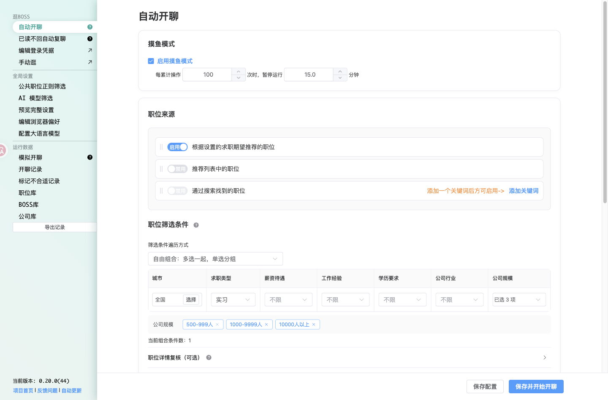
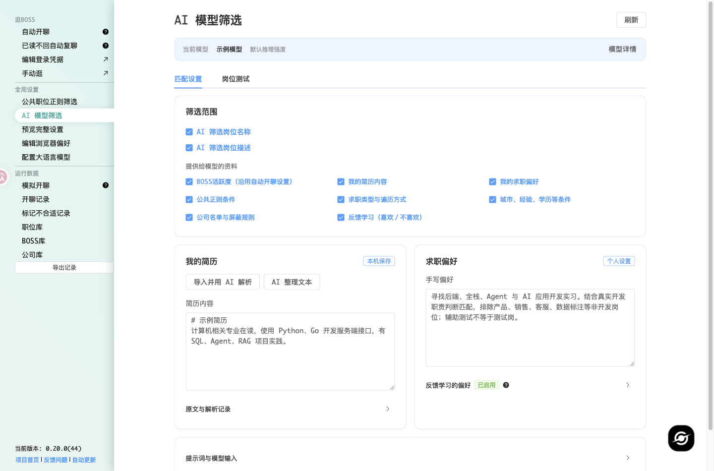
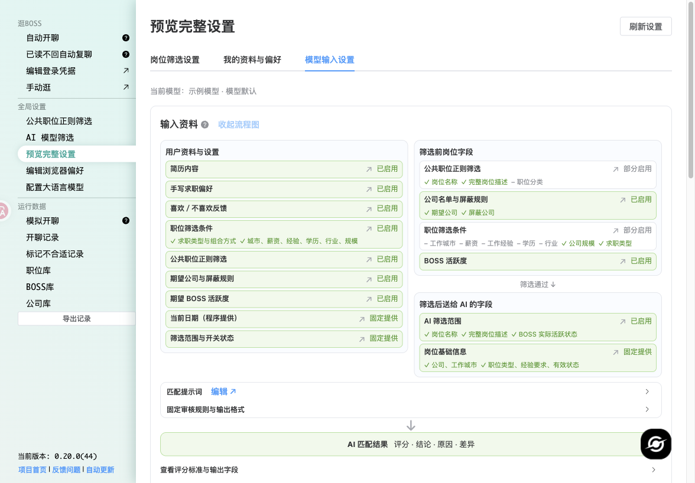
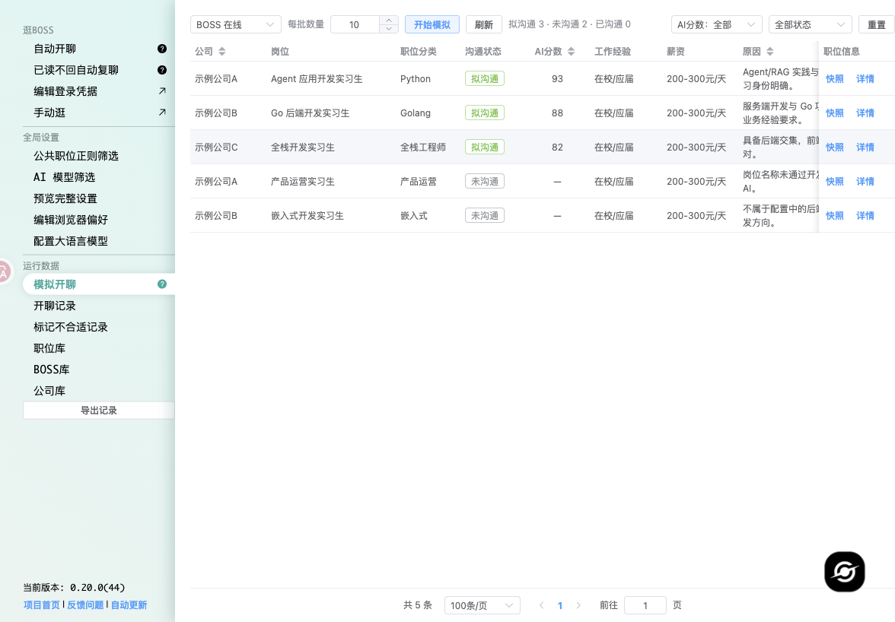
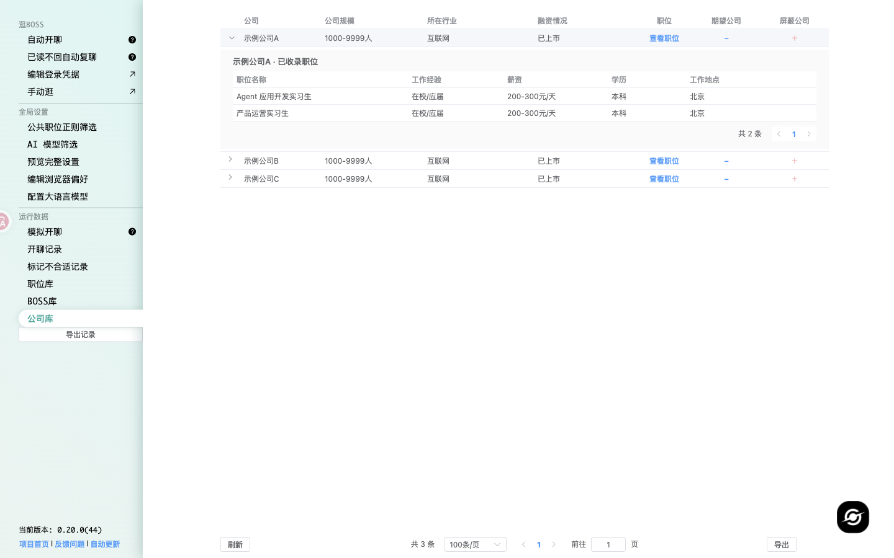

# Geek Geek Run-Pro

BOSS 直聘求职辅助桌面应用，基于 [GeekGeekRun（牛人快跑）](https://github.com/geekgeekrun/geekgeekrun) 开发。保留原有自动开聊、已读不回自动复聊及职位记录，增加可组合的正则与 AI 筛选、简历解析、反馈学习、模拟开聊和条件导出。

[下载安装包](https://github.com/lovits/geekgeekrun-pro/releases/latest) · [0.20.2 更新说明](docs/releases/ui-v0.20.2.md) · [反馈问题](https://github.com/lovits/geekgeekrun-pro/issues) · [原项目](https://github.com/geekgeekrun/geekgeekrun)

## 这次更新了什么

- 新增独立的**工作经验正则**，与岗位名称、职位分类、岗位描述分别启用。
- 详情规则先筛、AI 再匹配；仅本地标记时通过持久化队列后台记原因，保留失败恢复和去重。
- 开聊与不合适记录从已保存的岗位历史补取薪资原文，日薪、月薪、年包、面议按实际记录展示。
- 增加**评估失败**状态及对应导出筛选，区分模型异常与岗位不匹配。
- 正则预览使用可编辑中文说明，原始表达式折叠查看；修复输入勾选、反馈开关及实际活跃度的传递。
- 新安装不预填个人求职偏好，保留基础配置结构、匹配提示词与固定审核规则。

## 功能与入口

| 功能 | 在哪里 | 可以做什么 |
| --- | --- | --- |
| 职位来源与页面条件 | 自动开聊 | 配置推荐／搜索来源、城市、求职类型、薪资、经验、学历、行业、规模与活跃度 |
| 公共规则 | 全局设置 → 公共职位正则筛选 | 分别设置工作经验、名称、分类、描述、期望与屏蔽公司 |
| AI 匹配 | 全局设置 → AI 模型筛选 | 选择资料和岗位字段，结合个人能力与意向评分、解释差异 |
| 模型接入 | 全局设置 → 配置大语言模型 | 本机 Codex CLI 或 OpenAI 兼容 API，选择模型、推理强度与上下文 |
| 完整预览 | 全局设置 → 预览完整设置 | 查看岗位条件、个人资料、实际输入和可点击跳转的流程图 |
| 模拟开聊 | 运行数据 → 模拟开聊 | 使用本地职位或 BOSS 在线流程筛选，记录结果但不发起沟通 |
| 反馈学习 | 记录中的喜欢／不喜欢 | 用明确反馈补充软偏好，辅助后续 AI 判断，可启用或停用 |
| 职位与公司管理 | 职位库／公司库 | 按公司筛选、排序，预览公司岗位，切换期望与屏蔽公司 |
| 导出 | 运行数据 → 导出记录 | 按条件导出单类或全部历史数据，支持模拟记录 |
| 更新 | 左下角 → 自动更新 | 启动检查、每日检查、发布说明及新版下载 |

## 1. 安装与首次启动

在 [Releases](https://github.com/lovits/geekgeekrun-pro/releases/latest) 下载对应系统的包：

| 系统 | 0.20.2 安装包 | 使用方式 |
| --- | --- | --- |
| Mac，Apple 芯片 | `geekgeekrun-pro_0.20.2_arm64.dmg` | 打开并拖入 Applications |
| Mac，Intel | `geekgeekrun-pro_0.20.2_x64.dmg` | 打开并拖入 Applications |
| Windows 10／11，x64 | `geekgeekrun-pro_0.20.2_x64_setup.exe` | 运行安装程序，可选择安装目录 |
| Debian／Ubuntu，x64 | `geekgeekrun-pro_0.20.2_amd64.deb` | 用系统安装器安装 |

发布附件包含 `SHA256SUMS.txt`。Mac 包采用临时签名，未经过 Apple 公证；Windows 包未使用商业代码签名。遇到系统提示时，先核对下载来源和校验值，按系统针对该应用的提示操作。

首次启动后：

1. 在**全局设置 → 编辑浏览器偏好**中识别、选择或下载浏览器。
2. 在**编辑登录凭据**中扫码，完成验证并保存。
3. 配置职位条件；建议先模拟，再决定是否正式开聊。

新用户自行填写资料与偏好。安装包不包含开发者的简历、账号、API 密钥、登录信息、反馈和运行数据库。已有配置与记录保存在本机 `~/.geekgeekrun/`，升级继续使用。

## 2. 设置职位来源与页面条件

进入**自动开聊**，选择职位来源、筛选方式和允许的 BOSS 活跃度。



- **自由组合**：网页支持多选的栏位一起勾选；城市、薪资等单选栏位设置多个值时分组查询，不把可多选选项拆成全部子集。
- **固定组合**：预先填写几套条件，逐组查询，各组是替代关系。
- **同一栏内**通常满足任一项即可；**不同栏位**共同生效。页面控件本身的单选或数量限制仍然有效。
- 活跃度使用滑条设置。详情复核折叠区可补充精确限制。

求职类型的“实习／全职”与 Java、Python、算法工程师等“职位分类”不同。只找实习时选择实习；仅凭“在校／应届”或日薪不能证明岗位属于实习。

## 3. 设置公共正则和公司规则

进入**全局设置 → 公共职位正则筛选**。


1. 勾选需要执行的检查；各项可独立启用。
2. 添加期望、屏蔽公司标签，或选择内置公司模板；公司库也可维护名单。
3. 填写工作经验、名称、分类、描述正则。工作经验独立检查；名称、分类、描述按设置的“且／或”关系处理。
4. 可为表达式填写中文说明，再保存。预览优先展示说明，原始正则可展开查看。

例如，工作经验表达式 `在校|应届|\d+天/周\s*\d+个月` 可匹配“在校”“应届”和“4天/周 3个月”。这是格式示例，请按自己的要求填写。

**表达式决定实际筛选，中文说明由用户维护。** 修改正则后应同步核对说明；说明不参与匹配，也不调用大模型翻译正则。软件不把文档示例变成默认个人条件。

## 4. 可选：配置模型与个人资料

只用规则筛选无需接入模型。需要 AI 解析简历或匹配岗位时，进入**全局设置 → 配置大语言模型**。


| 接入方式 | 如何设置 |
| --- | --- |
| 本机 Codex | 在该电脑安装并登录 Codex，自动识别或手动选择 CLI 文件，刷新模型并测试连接 |
| OpenAI 兼容 API | 填写服务地址、模型名称、API Secret，启用并测试连接 |

Codex CLI 在本机运行，推理仍由配置的模型服务完成；模型列表和连接权限以实际账号为准。换电脑需要重新安装、登录或配置路径。推理强度和上下文设置不能突破所选模型的能力。

接着进入**AI 模型筛选**：



1. 选择 AI 检查岗位名称、岗位描述中的哪些字段。
2. 选择提供给模型的资料：简历、偏好、反馈、公共正则、求职类型与组合、页面条件、公司规则、活跃度。
3. 导入简历并用 AI 解析，或整理已有文本；结果可编辑，原 PDF 可预览。
4. 填写手写偏好与匹配提示词，先用岗位测试检查结果。

**求职偏好写“想做什么、会什么、有哪些限制”；匹配提示词写“如何比较和判断”。** 固定审核规则规定证据边界、评分和输出结构。资料是否交给模型，与规则是否由程序执行，是独立选择。

解析和评分使用启用的模型，所选资料会发给该模型服务。PDF 解析需要 Poppler，并受文件大小、页数及模型图片能力限制；详见[匹配说明](docs/ai-job-matching.md)。

## 5. 预览完整设置与执行流程

进入**预览完整设置**，查看岗位筛选设置、我的资料与偏好、模型输入设置。点击“输入资料”旁的流程图按钮展开流程，点击节点可回到原设置。



执行顺序为：

**职位列表初筛 → 详情规则复筛 → 按勾选组装模型输入 → AI 匹配 → 记录结果 → 正式任务最终核验。**

规则排除的岗位不调用 AI 评分。AI 仅接收本次实际组装的资料：没有选择某项输入，不代表用户不具备对应能力。模型结果包含结论、0–100 基础分、条件摘要、理由和差异；分数不是录用概率。

仅本地标记时，原因先保存到队列，再后台写入数据库，前台继续筛下一岗位；下次启动可恢复未完成记录。选择在 BOSS 网站标记时，仍等待当前标记完成后再切换。

## 6. 先模拟，再正式开聊

进入**运行数据 → 模拟开聊**，选择模式、输入批量数量，然后开始。



| 模式 | 数据与行为 |
| --- | --- |
| 本地职位库 | 分析已有未开聊岗位；不访问新岗位，不改变网站状态 |
| BOSS 在线 | 复用自动开聊来源和筛选流程；不点击沟通、不发送消息；网站标记遵循所选策略 |

结果分为**拟沟通、未沟通、已沟通、评估失败**。评估失败表示调用、资料或流程异常，不能当成已确认不合适。正式任务的成功开聊记录才属于已沟通。

列表支持状态和 AI 分数条件筛选，以及公司、分数、原因排序；同组按时间从新到旧排列，重置恢复默认。原因最多显示两行，悬停查看全文。

- **快照**查看保存时的资料与判断依据。
- **详情**用配置的招聘浏览器打开官方岗位链接，线上内容可能已变化。

需要正式沟通时，回到自动开聊检查配置并启动。已读不回自动复聊保留为独立功能，按需配置默认回复或大模型回复。

## 7. 反馈、职位管理与导出

**反馈学习**：点击喜欢／不喜欢，再次点击可取消。未标记无影响，关闭反馈输入后不使用反馈调整匹配。明确反馈通过 TF-IDF／Rocchio 生成相似度参考，并可交给模型整理反馈偏好；不训练模型，不修改手写偏好，不改变 BOSS 推荐算法。反馈调整不能把不匹配变成匹配。

**公司与职位管理**：公司库切换期望／屏蔽状态，并预览已收录职位；职位库支持按公司筛选与排序。两类公司状态互斥。



**导出记录**：可导出开聊、不合适、职位、公司、模拟开聊或全部历史；单类支持 CSV／JSON，按适用的公司、岗位、日期、偏好、原因、沟通状态和有无 AI 分数筛选，不限当前页。


薪资优先使用保存的原文；没有原始证据时显示“未记录”，不会把日薪、月薪或年包强行换算。导出不包含登录凭据或模型密钥。

## 8. 更新与开发验证

左下角的**自动更新**显示当前仓库、原仓库、版本与发布说明，支持检查更新和下载。检查结果分别显示有新版、已是最新或检查失败。更新来源是本项目的正式 GitHub Releases。

```sh
pnpm install --frozen-lockfile
node --test packages/utils/*.test.mjs packages/geek-auto-start-chat-with-boss/*.test.mjs packages/ui/src/renderer/src/features/CompanyTags/*.test.mjs packages/ui/src/renderer/src/features/JobFilterSettingsPreview/*.test.mjs packages/ui/src/renderer/src/features/JobModelInputPreview/*.test.mjs packages/ui/scripts/native-database.test.cjs
pnpm --dir packages/ui typecheck
pnpm --dir packages/ui build
```

发布流程在各自系统构建 Mac arm64、Mac x64、Windows x64 和 Linux x64，并检查包内数据库组件。自动化检查不等同于所有 Win10／Win11 设备上的 GUI 或 BOSS 在线验证。

本文截图来自实际界面和隔离的示例环境；公司、简历、岗位、模型与评分仅用于演示，不代表真实招聘信息或真实模型评分。

## 项目来源

本项目保留原项目作者信息与许可证，感谢 [GeekGeekRun](https://github.com/geekgeekrun/geekgeekrun) 的原有实现。请使用本人账号，按实际需求控制任务频率并检查筛选结果。
