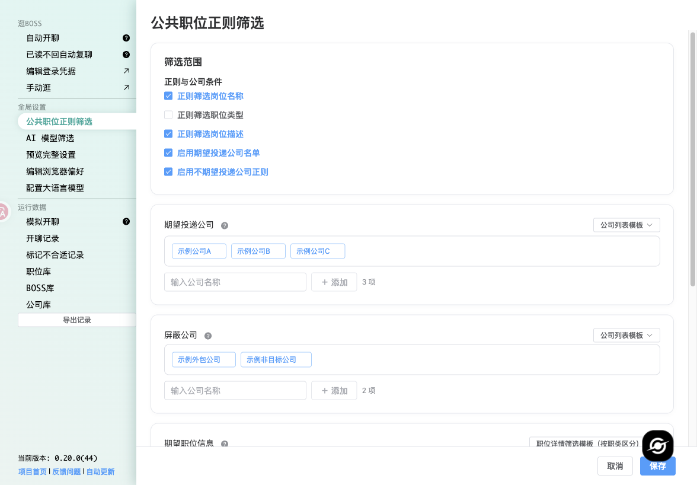
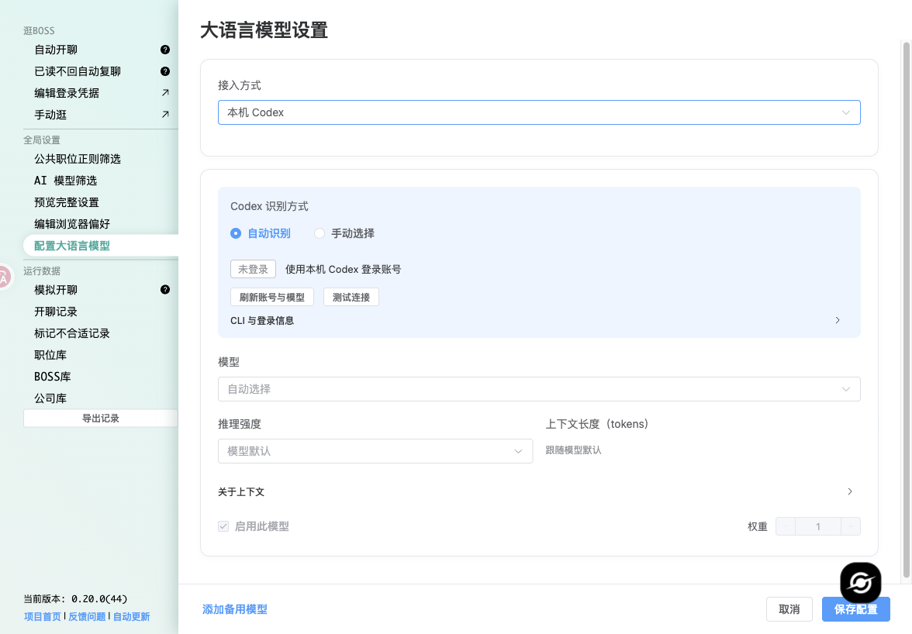
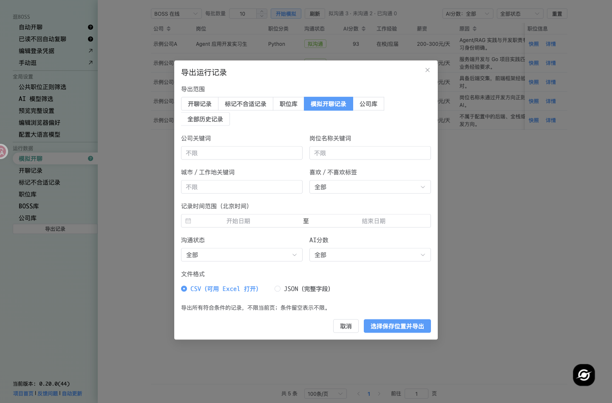

# GeekGeekRun Pro

基于 [GeekGeekRun（牛人快跑）](https://github.com/geekgeekrun/geekgeekrun) 二次开发的 BOSS 直聘求职辅助桌面应用。在原有自动开聊、已读不回自动复聊和职位记录的基础上，增加 AI 岗位匹配、简历解析、反馈学习、模拟开聊与记录导出。

**[下载安装包](https://github.com/lovits/geekgeekrun-pro/releases/latest)** · **[反馈问题](https://github.com/lovits/geekgeekrun-pro/issues)** · **[0.20.0 更新说明](docs/releases/0.20.0.md)** · **[原项目](https://github.com/geekgeekrun/geekgeekrun)**

本文按第一次使用的顺序介绍配置和操作。截图来自 0.20.0 实际界面，使用隔离环境中的示例资料；其中的公司、岗位、模型和分数仅用于演示，不代表真实招聘信息或真实模型评分。

## 能做什么

| 功能 | 入口 | 用途 |
| --- | --- | --- |
| 页面条件与活跃度 | 自动开聊 | 设置职位来源、城市、求职类型、薪资、经验、学历、行业、规模和 BOSS 活跃度 |
| 正则与公司筛选 | 公共职位正则筛选 | 独立启用岗位名称、职位分类、描述、期望公司和屏蔽公司规则 |
| 简历与 AI 匹配 | AI 模型筛选 | 导入简历、填写偏好和提示词，按所选岗位字段评分并说明差异 |
| 完整配置预览 | 预览完整设置 | 汇总当前设置，查看模型输入流程，点击节点回到相应配置 |
| 模拟开聊 | 运行数据 → 模拟开聊 | 分析本地职位，或在线浏览并筛选，记录结果但不发起沟通 |
| 反馈学习 | 记录中的喜欢／不喜欢 | 根据明确反馈补充软偏好，影响后续 AI 匹配 |
| 职位与公司管理 | 职位库／公司库 | 按公司筛选职位、查看公司已收录职位、维护期望和屏蔽公司 |
| 记录导出 | 导出记录 | 按条件导出开聊、不合适、职位、公司和模拟记录 |
| 更新检查 | 左下角 → 自动更新 | 查看本仓库正式版本、发布说明并下载安装包 |

## 1. 下载与安装

在 [Releases](https://github.com/lovits/geekgeekrun-pro/releases/latest) 中选择系统与处理器对应的安装包。当前版本为 **0.20.0**。

| 系统 | 安装包 | 安装方法 |
| --- | --- | --- |
| macOS，Apple Silicon（M 系列） | `geekgeekrun-pro_0.20.0_arm64.dmg` | 打开 DMG，将应用拖入 Applications |
| macOS，Intel | `geekgeekrun-pro_0.20.0_x64.dmg` | 打开 DMG，将应用拖入 Applications |
| Windows 10／11，x64 | `geekgeekrun-pro_0.20.0_x64_setup.exe` | 运行安装程序，按提示完成安装 |
| Debian／Ubuntu，x64 | `geekgeekrun-pro_0.20.0_amd64.deb` | 使用软件安装器或 `sudo apt install ./安装包文件名.deb` |

发布页提供 `SHA256SUMS.txt`。macOS 安装包采用临时签名，尚未经过 Apple 公证；Windows 安装包未使用商业代码签名。遇到系统拦截时先核对下载来源和校验值，再按系统对单个应用的安全提示处理，不需要关闭整台电脑的安全检查。

0.20.0 已完成各平台构建与安装包内 SQLite 原生模块检查。Windows 构建在 Windows Server 2022 CI 上验证，尚不等同于在所有 Windows 10／11 设备上完成完整 GUI 测试。

## 2. 第一次启动：配置浏览器并登录

1. 打开应用，进入 **全局设置 → 编辑浏览器偏好**，按界面引导识别、选择或下载受支持的浏览器。
2. 点击 **编辑登录凭据**，在打开的 BOSS 页面完成本人扫码或安全验证。
3. 回到应用，先配置筛选条件，再使用模拟开聊检查结果。

招聘页面和职位「详情」通过应用配置的招聘浏览器打开。登录状态失效、出现验证码或网站环境验证时，需要本人在页面处理。

## 3. 配置要找的职位

进入 **自动开聊**。先选择职位来源，再设置下面的 **职位筛选条件**。


### 职位来源

可以启用按求职期望推荐、推荐列表、关键词搜索等来源，并调整执行顺序。关键词搜索需要先添加关键词。

### 页面筛选条件

城市、求职类型、薪资、工作经验、学历、公司行业和公司规模会用于 BOSS 页面筛选。只找实习时，将 **求职类型选择为「实习」**；「在校／应届」是经验要求，不能单独代替实习身份。

**自由组合：多选一起，单选分组** 按页面控件的能力执行：

- 经验、学历、公司规模等支持多选的栏位，在同一组中一起勾选；同一栏内是「或」关系。
- 城市、薪资等单选栏位如果设置多个值，则分组遍历；不会假装在网页上同时选中多个单选项。
- 不同栏位之间共同生效。自由组合不会额外生成一个放宽所有已选条件的「不限」组；没有设置的栏位本身保持不限。
- 行业目前每组最多选择三项，更多选择需要分组。组合数会同步显示在界面和完整设置预览中。

例如，只选「全国＋实习＋500–999 人、1000–9999 人、10000 人以上」，公司规模三项一起勾选，**组合数为 1**。再选两个薪资档位，则需要分别查询两个组合，而不是把公司规模拆成所有子集。

**固定组合** 适合分别设置几套完整条件；程序按照表格中的组合逐行执行。

### 活跃度与详情复核

使用 **允许的 BOSS 活跃度** 滑条设置范围，例如「本周活跃」或「3 日内活跃」。这个值同时显示在完整设置预览中；是否再交给 AI 理解，由 AI 输入资料中的活跃度选项决定。

「职位详情复核（可选）」用于额外的工作地、薪资等精确限制。没有额外要求时无需展开设置。

## 4. 配置公共正则与公司规则

进入 **全局设置 → 公共职位正则筛选**。



1. 在「筛选范围」中启用需要的规则，各项可以分别开关。
2. 期望公司、屏蔽公司支持添加标签；鼠标移到公司标签上可删除。也可以从公司列表模板选择。
3. 岗位名称、职位分类和岗位描述使用正则表达式；可以选模板后再修改。
4. 选择名称／分类／描述之间的「且」或「或」逻辑，然后保存。

这里的 **职位分类** 指 BOSS 的 Java、Python、算法工程师等职类，不是「全职／实习」求职类型。规则旁的问号可查看具体匹配方式。

例如，名称正则 `后端|服务端|全栈|Agent|智能体|AI应用` 表示名称命中其中任一表达。描述中「协助产品人员」「编写测试」是否排除，应由你实际填写的规则决定，不会仅凭软件界面说明自动添加排除条件。

开启的正则规则会先独立执行，再进入 AI 匹配。修改规则后，完整设置预览会同步读取当前规则；复杂正则的可读说明只是辅助，执行仍以保存的正则为准。

## 5. 可选：接入大语言模型

进入 **全局设置 → 配置大语言模型**。只使用正则筛选时，不必配置模型。



| 接入方式 | 配置步骤 | 使用什么账号或凭据 |
| --- | --- | --- |
| 本机 Codex | 先安装并登录 Codex；选择自动识别，或手动选择 CLI 可执行文件；刷新账号与模型后测试连接 | 本机 Codex 已登录账号，实际可用模型取决于该账号与 CLI |
| API 接入（OpenAI 兼容） | 填写 Base URL、模型名称和 API Secret，启用后保存 | 所配置服务的 API 凭据 |

本机 Codex 是通过本地 CLI 调用模型服务，并不意味着模型权重在电脑上运行，也不是把订阅转换成通用 API Key。其他设备需要分别安装和登录，不能直接照抄另一台电脑的可执行文件路径。

自动识别失败时，展开「CLI 与登录信息」查看路径，再使用手动选择。macOS 的路径可能是 `/opt/homebrew/bin/codex`；Windows 应选择实际安装的 `codex.exe`。界面提供示例，但以本机文件为准。

模型列表、可选推理强度和上下文范围会依据识别结果显示。选择账号真正可用的模型；上下文设置不能突破模型本身的能力。简历解析、岗位匹配和反馈偏好整理使用配置的模型服务，所选资料会发送给该服务。

## 6. 填写简历、偏好与匹配提示词

进入 **全局设置 → AI 模型筛选**。


1. 选择 AI 要检查 **岗位名称、岗位描述** 中的哪些字段。希望结合实际职责判断时，应勾选岗位描述。
2. 勾选要提供给模型的资料，例如简历、求职偏好、公共正则、页面条件、公司规则、活跃度及反馈。
3. 点击「导入并用 AI 解析」导入简历，检查解析后的文字；也可以编辑文字后使用「AI 整理文本」。已导入的原始 PDF 可以点击预览。
4. 填写手写偏好与匹配提示词。使用「岗位测试」检查几条结果，再决定是否用于正式任务。

**手写偏好写「你要什么」**：目标职责、语言、实习类型、城市、资格要求和排除方向。

> 示例：寻找后端、全栈、Agent 与 AI 应用开发实习。结合我的简历判断真实开发职责；辅助测试不等于测试岗。排除产品、销售、客服和数据标注等非开发岗位，明确指出资格差异。

**匹配提示词写「模型如何判断」**：核查顺序、证据要求、缺失信息的处理和解释方式。

> 示例：先核对实习身份与资格，再比较岗位职责、技术栈和简历证据。只使用实际提供的信息；不要因为出现 AI 就认定匹配。给出匹配结论、分数、具体原因和待确认差异，缺失信息不要猜测。

上述只是填写示例。软件按你保存的配置执行，不会把示例方向、公司或个人条件强加给其他用户。

评分由职责、技能、资格和偏好构成，模型返回匹配结论、0–100 分、原因和差异。**分数是匹配参考，不是录取概率**；硬性不符不能靠高分放行。没有启用 AI，或岗位已被前置规则排除时，可以没有 AI 分数。模型调用失败也不会被当作通过。

## 7. 预览完整设置：确认模型到底看到了什么

进入 **全局设置 → 预览完整设置**，分别查看「岗位筛选设置」「我的资料与偏好」「模型输入设置」。

在「模型输入设置」点击「输入资料」旁的 **流程图**，可以展开当前匹配流程。


流程分为两侧：

- **用户资料与设置**：简历、手写偏好、反馈，以及勾选的筛选条件。
- **岗位资料**：BOSS 提供的字段先经过已启用的页面与正则规则；通过后，选中的名称／描述等信息才进入 AI。

匹配提示词和固定审核规则单独列出，最终输出评分、结论、原因与差异。绿色表示启用，灰色表示未启用；部分启用和固定提供会分别标明。点击可配置节点可跳回原设置位置修改，图本身不会另外保存一套配置。

## 8. 先模拟，再决定是否正式开聊

进入 **运行数据 → 模拟开聊**，选择模式，输入每批数量，点击「开始模拟」。


| 模式 | 数据从哪里来 | 会做哪些网站操作 |
| --- | --- | --- |
| 本地职位库 | 已收录的本地岗位与描述，排除本地已开聊记录 | 不浏览新岗位，不发送消息，不改变网站状态 |
| BOSS 在线 | 复用自动开聊的入口、职位来源和筛选流程 | 浏览与筛选岗位，不点击沟通、不发送消息；可能按已配置策略在 BOSS 标记不合适 |

本地模式适合检查已有数据与筛选逻辑，不能证明岗位现在仍开放。在线模式适合观察当前配置在实际网站上会筛出什么。

### 怎么看结果

| 状态 | 含义 |
| --- | --- |
| 拟沟通 | 已记录为候选，但尚未实际发起沟通 |
| 未沟通 | 当前判断未通过，查看具体原因 |
| 已沟通 | 已有真实任务的成功开聊记录，不由模拟操作伪造 |

缺失信息、调用失败等情况请结合原因查看，不能直接当作符合条件。列表支持沟通状态、是否有 AI 分数筛选，以及公司、分数、原因排序；同组按时间从新到旧排列。「重置」恢复默认视图。原因最多展示两行，悬停查看全文。

- **快照**：查看本地保存的岗位信息与判断依据。
- **详情**：用配置的招聘浏览器打开实际岗位链接；网站当前内容可能已变化。

正式运行前，回到自动开聊检查配置，再点击「保存并开始开聊」。正式任务会尝试发起沟通；模拟任务不会。两者的筛选结果会汇入模拟列表，真实开聊与不合适记录仍保留各自入口。

已读不回自动复聊是独立功能，保留原有默认回复与大模型回复配置，需要时再单独启用。

## 9. 喜欢／不喜欢如何影响下一次匹配

在支持反馈的记录中标记喜欢或不喜欢，再点一次可以取消。**未标记没有学习信号**；未配置可用模型时，反馈按钮灰显。

反馈链路是：**明确标记 → 更新反馈样本 → TF-IDF／Rocchio 计算职责相似度 → 整理反馈偏好 → 下一次 AI 匹配读取已勾选的反馈资料 → 单独调整分数**。

- 依据岗位名称与职责文本比较相似点，分别计算喜欢和不喜欢样本的文本中心。
- 相关反馈样本和学习偏好会作为补充资料提供给 AI；独立分数调整最多 ±10 分，不让模型重复加减。
- 学习内容显示在「AI 模型筛选 → 求职偏好 → 反馈学习的偏好」，不覆盖你的手写偏好，也不能越过硬性规则。
- 关闭输入资料中的「反馈学习」后，原始标记仍保留，但不再影响本次模型输入与反馈分数；重新开启时依据现存标记重建。

这是轻量的内容推荐，不是在本地训练或微调大模型。它不会只因为同公司或同语言，就把某个岗位的好恶推广到全部岗位。

## 10. 管理职位、公司与记录

### 从公司查看职位

进入 **公司库**，点击某行「查看职位」，会在原表内展开该公司已收录的职位，显示名称、经验、薪资、学历和地点。


「期望公司」「屏蔽公司」列使用加减按钮：添加后变成减号，再点移除。同一公司不能同时存在于两份名单。职位库也支持按公司筛选和公司排序，查询覆盖完整数据，不限当前页。

开聊记录、标记不合适记录、职位库、BOSS 库和公司库保留各自表头与分页。职位库收录表示曾采集，不等于该岗位已匹配通过或仍在招聘。

### 导出记录

点击左侧 **导出记录**，先选择范围，再填写需要的条件，最后选择保存位置。



| 导出范围 | 可用条件 |
| --- | --- |
| 开聊记录、职位库 | 公司、岗位、城市、记录日期、喜欢／不喜欢标签 |
| 标记不合适记录 | 上述条件，以及不合适原因 |
| 模拟开聊记录 | 上述通用条件，以及沟通状态、有无 AI 分数 |
| 公司库 | 公司、行业关键词 |
| 全部历史记录 | 完整历史数据、反馈、模拟记录和评分等，以 JSON 导出 |

单类记录支持 CSV 或 JSON；CSV 可以用 Excel 打开。导出覆盖全部符合条件的记录，不限当前页。BOSS 库没有单独导出选项。「全部历史记录」不是整个应用目录的文件级备份，不代替对原始简历和配置文件的备份。

## 11. 更新与本地数据

左下角「项目首页」「反馈问题」「自动更新」指向本仓库，更新页同时保留原仓库入口。

启动时按检查策略查询更新，自动检查每 24 小时最多一次，也可以手动检查。结果分为「发现新版本」「已是最新」「检查失败」；检查失败不等于没有更新。启用自动下载时，会下载对应平台与架构的安装包并显示发布说明，安装由本人确认，不会静默覆盖正在运行的程序。

**仓库改名说明：** 原地址 `lovits/geekgeekrun` 已改为 `lovits/geekgeekrun-pro`。已有 0.20.0 安装包保留原构建内容，其下载校验仍使用旧仓库路径；如内置更新下载报错，请先从上方新 Releases 页面手动下载。当前源码已同步新地址，不会把旧安装包冒充成重新构建的版本。

本地配置与数据目录：

| 系统 | 目录 |
| --- | --- |
| macOS／Linux | `~/.geekgeekrun` |
| Windows | `%USERPROFILE%\.geekgeekrun` |

配置、SQLite 数据库、反馈、运行记录与导入的简历保存在应用数据目录。完整迁移前先退出应用并备份这个目录；不要把登录凭据、API Secret、个人简历或个人运行数据提交到公开仓库。使用 AI 时，勾选的资料会按接入方式发送给对应模型服务。

程序依赖本机运行和网络，不提供合盖休眠、关机或离线后仍持续执行的保证。BOSS 页面改版、登录状态或账号限制也会影响在线功能；遇到验证应在网站正常完成。

## 12. 从源码运行与构建

开发环境使用 **Node.js 22、pnpm 8.15.9**，与当前跨平台构建流程保持一致。桌面版入口在 `packages/ui`，根目录 `pnpm start` 是另一套核心程序入口。

```bash
git clone https://github.com/lovits/geekgeekrun-pro.git
cd geekgeekrun-pro
corepack enable
corepack prepare pnpm@8.15.9 --activate
pnpm install --frozen-lockfile

# 开发模式启动桌面界面
pnpm --dir packages/ui dev
```

```bash
# 检查类型与构建应用代码
pnpm --dir packages/ui typecheck
pnpm --dir packages/ui build

# 在当前系统构建安装包，不发布到 GitHub
pnpm --dir packages/ui build:make-dist-for-current-platform

# Windows x64（请在 Windows 构建环境执行）
pnpm --dir packages/ui build:win
```

安装包输出到 `packages/ui/dist`。macOS 的 arm64 和 x64 包分别使用对应架构构建。SQLite 是原生依赖，不能把 macOS 的 `node_modules` 直接复制给 Windows 使用；构建脚本会处理相应平台及 Electron ABI。

源码测试示例：

```bash
node --test packages/utils/*.test.mjs packages/geek-auto-start-chat-with-boss/*.test.mjs
```

包含真实页面控件的测试还需要 Puppeteer 对应的 Chrome，可使用 `pnpm exec puppeteer browsers install chrome` 安装。完整发布流程见 [.github/workflows/release-ui.yml](.github/workflows/release-ui.yml)：手动触发可构建与验证安装包；推送 `ui-v*` 标签会进入发布流程。

### 主要目录

| 目录 | 内容 |
| --- | --- |
| `packages/ui` | Electron 主进程、Vue 界面、IPC、打包与安装包检查 |
| `packages/geek-auto-start-chat-with-boss` | BOSS 浏览、筛选、开聊及相关任务流程 |
| `packages/utils` | AI 匹配、反馈推荐、记录处理、导出和更新等共享逻辑 |
| `packages/sqlite-plugin` | 职位、公司、BOSS 与历史记录存储 |
| `docs/images` | 本指南中的实际界面截图 |
| `docs/releases` | 发布说明 |

## 常见问题

**为什么没有 AI 分数？** 没启用 AI、所需资料不完整、模型调用失败，或岗位已被前置规则拒绝，都可能没有分数。先看原因，再检查 AI 的字段与资料开关。

**为什么改了设置，预览没变化？** 确认已在原页面保存，再进入完整设置点击「刷新设置」。流程图展示实际保存的开关，不能只修改说明文字。

**为什么能看到职位，却不能打开详情？** 本地快照与当前网站是两份不同时间的数据。详情可能需要登录、已失效，或受网站访问限制；这不代表本地快照来自当前页面。

**换电脑后 Codex 能直接用吗？** 需要在新设备安装并登录 CLI，再识别本机可执行文件。模型权限、路径和登录状态以新设备为准。

## 原项目与贡献

GeekGeekRun Pro 基于 [geekgeekrun/geekgeekrun](https://github.com/geekgeekrun/geekgeekrun) 开发，原项目名称为「牛人快跑 - GeekGeekRun」。感谢原作者与贡献者提供的浏览器自动化、桌面应用和职位数据管理基础；本 Fork 的改动可以在提交历史中查看。仓库 `package.json` 的许可声明为 ISC，原作者的代码贡献与署名予以保留。

功能问题请提交到 [本仓库 Issues](https://github.com/lovits/geekgeekrun-pro/issues)，附上系统、应用版本、复现步骤和去除个人信息后的截图。不要在 Issue 中粘贴 Cookie、密钥或完整简历。
